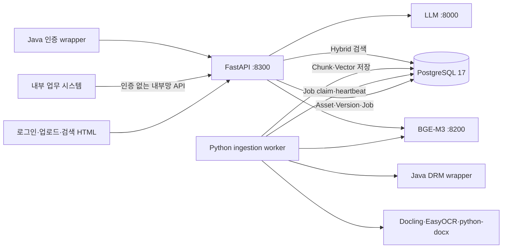

# ECM-RAG 설치·연동·운영·디버깅 매뉴얼

## 1. 문서 목적과 적용 범위

이 문서는 회사 내부 네트워크의 Rocky Linux 9 PC에 ECM-RAG를 처음 설치하고, 운영자가
별도 개발 지원 없이 설정·기동·점검·장애 분석할 수 있도록 작성한 기준 절차입니다.

기준 구성은 다음과 같습니다.

- OS: Rocky Linux 9
- Python: 3.11
- API/UI: FastAPI + 정적 HTML/JavaScript
- DB: PostgreSQL 17 + `pgvector` + `pg_trgm`
- 문서 처리: Docling 2.118.1, python-docx 1.2.0, EasyOCR 1.7.2
- 임베딩: OpenAI 호환 BGE-M3 API
- 답변 생성: OpenAI 호환 사내 LLM API
- 인증: 사내 Java 인증 wrapper
- DRM: Java DRM wrapper
- 프로세스: FastAPI와 ingestion worker 분리
- 저장소: PostgreSQL/pgvector 단일 저장소, ChromaDB 미사용

Windows/WSL 테스트 PC를 구축하는 경우에는 이 문서와 함께
[`LOCAL_PC_TEST_ENV_SETUP.md`](LOCAL_PC_TEST_ENV_SETUP.md)를 참고합니다.

## 2. 전체 구조

다음 Mermaid 원문은 Markdown 편집기에서 직접 수정할 수 있습니다. 별도 편집용 구성도는
[`ARCHITECTURE_EDITABLE.mmd`](ARCHITECTURE_EDITABLE.mmd)에 있습니다.



핵심 원칙은 다음과 같습니다.

1. API는 파일 접수와 DB 작업 등록만 하고 PDF 파싱은 수행하지 않습니다.
2. Worker는 PostgreSQL queue를 가져가 DRM, 파싱, OCR, 임베딩, 저장을 수행합니다.
3. 검색은 PostgreSQL exact/FTS와 pgvector cosine 검색을 RRF로 결합합니다. cosine
   distance가 `retrieval.max_vector_distance`보다 크고 exact/FTS 근거도 없으면 일반
   대화로 판단하여 LLM을 호출하지 않습니다.
4. `/api/v1/chat`은 로그인 세션을 요구하고, `/api/v1/external/answer`는 내부망 연동을
   위해 인증하지 않습니다.
5. 무인증 endpoint의 접근 제어는 호스트 방화벽 또는 reverse proxy ACL 책임입니다.

## 3. 네트워크 및 연동 사전 점검

### 3.1 포트 흐름

| 출발지 | 목적지 | 기본 포트 | 용도 | 필수 여부 |
|---|---|---:|---|---|
| 사용자/업무 PC | ECM-RAG API 서버 | 8300/TCP | 화면, 업로드, 검색, 외부 연동 API | 필수 |
| ECM-RAG API/Worker | PostgreSQL | 5432/TCP | 메타데이터, queue, 청크, vector | 필수 |
| ECM-RAG API/Worker | 임베딩 서버 | 8200/TCP | BGE-M3 embedding | 필수 |
| ECM-RAG API | LLM 서버 | 8000/TCP | 검색 근거 기반 답변 | 채팅 사용 시 필수 |
| ECM-RAG API | Java 인증 wrapper | 로컬 프로세스 | 사내 계정 인증 | UI 로그인 시 필수 |
| ECM-RAG Worker | Java DRM wrapper | 로컬 프로세스 | 원본 복호화 | DRM 활성화 시 필수 |

현재 알려진 모델 서버 예시는 다음과 같습니다.

```text
Embedding: http://192.168.1.31:8200/v1/embeddings
LLM API root: http://192.168.1.31:8000/v1
```

실제 회사망에서는 서버 IP, 라우팅, 방화벽 정책을 운영 담당자에게 확인합니다.

Rocky Linux의 firewalld를 사용하는 경우 회사에서 승인한 호출 대역만 허용합니다. 아래
`사내CIDR`은 실제 네트워크 대역으로 바꿔야 하며 `0.0.0.0/0`을 사용하지 않습니다.

```bash
sudo firewall-cmd --permanent --add-rich-rule='rule family="ipv4" source address="사내CIDR" port port="8300" protocol="tcp" accept'
sudo firewall-cmd --reload
sudo firewall-cmd --list-rich-rules
```

reverse proxy를 추가하는 경우 무인증 `/api/v1/external/answer`에도 동일한 사내 CIDR ACL을
적용합니다. 프록시를 거치지 않는 8300 포트가 다른 대역에 열려 있지 않은지 함께 확인합니다.

### 3.2 연결 확인

ECM-RAG 서버에서 실행합니다.

```bash
curl -v --connect-timeout 5 http://192.168.1.31:8200/v1/embeddings
curl -v --connect-timeout 5 http://192.168.1.31:8000/v1/models
nc -vz DB서버주소 5432
```

임베딩 endpoint는 GET을 지원하지 않아 404/405가 나올 수 있습니다. 이 경우에도 TCP 연결이
되었다면 실제 POST 검증을 진행합니다.

```bash
curl -sS http://192.168.1.31:8200/v1/embeddings \
  -H 'Content-Type: application/json' \
  -d '{"model":"bge-m3","input":["연결 시험"]}'
```

응답의 `data[0].embedding` 길이는 DB의 `vector(1024)`와 같은 1024여야 합니다.

## 4. 디렉터리와 서비스 계정

운영 예시는 `sngjng` 계정과 `/srv/ecm-rag` 경로를 사용합니다. 회사 표준 계정이 다르면
경로와 실행 계정을 일관되게 바꿉니다.

```bash
sudo install -d -o sngjng -g sngjng -m 750 /srv/ecm-rag
sudo install -d -o sngjng -g sngjng -m 700 /srv/ecm-rag/uploads
sudo install -d -o sngjng -g sngjng -m 700 /srv/ecm-rag/processed
sudo install -d -o sngjng -g sngjng -m 750 /srv/models/docling
sudo install -d -o sngjng -g sngjng -m 750 /srv/models/bge-reranker-v2-m3
```

역할은 다음과 같습니다.

| 경로 | 내용 | 백업 필요 |
|---|---|---|
| `/srv/ecm-rag` | 애플리케이션 소스와 가상환경 | 소스는 Git, 설정은 별도 백업 |
| `/srv/ecm-rag/uploads` | 등록 원본 파일 | 필수 |
| `/srv/ecm-rag/processed` | Docling JSON, Markdown, canonical JSON | 권장 |
| `/srv/models/docling` | Docling 오프라인 모델 artifact | 설치 매체로 복구 가능 |
| `~/.EasyOCR/model` | EasyOCR 모델 weight | 폐쇄망에서는 사전 반입 필수 |
| `/srv/models/bge-reranker-v2-m3` | 선택적 reranker 모델 | reranker 사용 시 필수 |

원본 경로를 나중에 변경하면 DB의 `asset_versions.source_path`와 실제 파일 경로가 달라집니다.
기존 문서 다운로드와 미처리 작업이 실패할 수 있으므로, 경로 변경은 파일 이동·DB 갱신·검증을
하나의 변경 작업으로 계획해야 합니다.

## 5. Rocky Linux 9 OS 패키지

사내 DNF mirror를 사용합니다. 패키지 이름은 사내 표준 이미지에 따라 다를 수 있으므로
미러 담당자와 확인합니다.

```bash
sudo dnf install -y \
  python3.11 python3.11-pip python3.11-devel \
  gcc gcc-c++ make git curl jq \
  libGL glib2 libgomp poppler-utils \
  java-17-openjdk-headless
```

확인:

```bash
python3.11 --version
java -version
curl --version
```

GPU 환경이면 Python 설치 전에 NVIDIA driver와 CUDA 호환성을 확인합니다.

```bash
nvidia-smi
```

`torch==2.12.1`과 운영 제약 파일에 기록된 CUDA 패키지가 대상 GPU driver에서 동작해야
합니다. GPU driver 변경은 모델 담당자와 함께 검증합니다.

## 6. 소스 배포

온라인 Git 접근이 가능하면:

```bash
cd /srv
git clone https://github.com/sngjng/ecm-rag.git
cd /srv/ecm-rag
git status
git log -1 --oneline
```

폐쇄망이면 승인된 반입 매체로 Git bundle 또는 소스 압축 파일을 전달합니다. 반입 전에
다음 파일이 포함되지 않았는지 확인합니다.

- `.env`
- DB 비밀번호 및 API key
- 실제 사내 원본 문서
- 인증 쿠키와 로그
- Java 라이브러리 라이선스상 반입 금지 파일

## 7. Python 3.11 가상환경과 라이브러리

### 7.1 가상환경 생성

```bash
cd /srv/ecm-rag
python3.11 -m venv .venv
source .venv/bin/activate
python -m pip install --upgrade pip
```

### 7.2 설치 파일 구조

- `requirements.txt`: 프로젝트가 직접 사용하는 패키지와 검증 버전
- `constraints/operations-py311.txt`: 운영 `pip list`를 기준으로 고정한 직접·간접 버전
- `requirements-dev.txt`: 테스트 도구까지 필요한 개발 PC용

운영 설치:

```bash
python -m pip install -r requirements.txt
python -m pip check
```

개발·자동 테스트 PC:

```bash
python -m pip install -r requirements-dev.txt
```

### 7.3 주요 라이브러리와 역할

| 라이브러리 | 고정 버전 | 역할 |
|---|---:|---|
| fastapi | 0.136.1 | HTTP API와 입력 검증 |
| uvicorn | 0.46.0 | ASGI 서버, 다중 API worker |
| pydantic | 2.13.3 | API/YAML 설정 모델 검증 |
| PyYAML | 6.0.3 | 공통·profile 설정 로딩 |
| psycopg[binary] | 3.3.6 | PostgreSQL 트랜잭션과 SQL 실행 |
| pgvector | 0.5.0 | Python/NumPy vector 타입 연결 |
| httpx | 0.28.1 | 임베딩·LLM HTTP 호출 |
| docling | 2.118.1 | PDF 구조·표·본문 변환 |
| python-docx | 1.2.0 | DOCX 문단·표 처리 |
| easyocr | 1.7.2 | 현재 선택된 OCR 엔진 |
| rapidocr | 3.9.2 | 설치 호환성 유지, 현재 비활성 |
| onnxruntime | 1.25.0 | RapidOCR 실행 기반, 현재 선택하지 않음 |
| PyMuPDF | 1.28.0 | PDF 처리 의존성 |
| Pillow | 12.2.0 | 이미지 처리 |
| opencv-python-headless | 5.0.0.93 | 서버용 OCR 영상 처리 |
| torch | 2.12.1 | Docling/EasyOCR/모델 실행 |
| sentence-transformers | 5.4.1 | 임베딩/reranker 모델 기반 |
| transformers | 5.6.2 | 모델 로딩 기반 |
| FlagEmbedding | 1.4.2 | 선택적 BGE reranker |
| numpy | 2.4.4 | vector 검증·변환 |
| tree-sitter-language-pack | 1.21.3 | Java 소스 심볼 추출 |

ChromaDB는 제거 대상 요구사항에 따라 어떤 설치 파일에도 포함하지 않습니다.

### 7.4 완전 폐쇄망 wheel 반입

대상 서버와 같은 OS/CPU/Python 및 가능한 한 같은 GPU 조건의 준비 PC에서 수행합니다.

```bash
mkdir -p wheelhouse
python3.11 -m pip download -r requirements.txt -d wheelhouse
tar -czf ecm-rag-wheelhouse-py311.tar.gz wheelhouse requirements.txt constraints
```

폐쇄망 서버:

```bash
tar -xzf ecm-rag-wheelhouse-py311.tar.gz
source .venv/bin/activate
python -m pip install --no-index --find-links wheelhouse -r requirements.txt
python -m pip check
```

Docling와 EasyOCR 모델 weight는 wheel에 포함되지 않을 수 있습니다. 준비 PC에서 모델을
미리 내려받아 `/srv/models/docling`, `~/.EasyOCR/model`에 별도로 반입합니다. 운영 기동 전
외부 인터넷을 차단한 상태로 PDF 한 건을 처리해 누락 artifact가 없는지 검증합니다.

## 8. PostgreSQL 17과 pgvector

### 8.1 준비 조건

- PostgreSQL 17 서버/클라이언트
- `vector` extension
- `pg_trgm` extension
- UTF-8 database
- ECM-RAG 서버에서 DB 포트 접근 가능

DBA 예시:

```sql
CREATE ROLE raguser LOGIN PASSWORD '별도보관비밀번호';
CREATE DATABASE ragdb OWNER raguser ENCODING 'UTF8';
```

DBA 권한으로 확장을 준비합니다.

```sql
\c ragdb
CREATE EXTENSION IF NOT EXISTS vector;
CREATE EXTENSION IF NOT EXISTS pg_trgm;
```

### 8.2 스키마 적용

기본 embedding 차원은 1024입니다. 다른 모델을 사용할 경우 YAML의
`models.embedding.dimension`과 SQL의 `vector(1024)`를 반드시 같이 변경합니다.

```bash
cd /srv/ecm-rag
source .venv/bin/activate
export RAG_PROFILE=rockylinux9
export RAG_DB_DSN='postgresql://raguser:비밀번호@DB주소:5432/ragdb'

python scripts/render_pgvector_sql.py \
  --output artifacts/sql/001_pgvector.rendered.sql
psql "$RAG_DB_DSN" -v ON_ERROR_STOP=1 \
  -f artifacts/sql/001_pgvector.rendered.sql
```

`bin/start.sh`는 증분 migration `002_session_auth_audit.sql`과
`003_code_symbol_stack_lookup.sql`을 매번 안전하게 확인하지만, 신규 DB의
`001_pgvector.sql`은 자동 생성하지 않습니다.

검증:

```bash
psql "$RAG_DB_DSN" -c \
  "SELECT extname FROM pg_extension WHERE extname IN ('vector','pg_trgm');"
psql "$RAG_DB_DSN" -c \
  "SELECT tablename FROM pg_tables WHERE schemaname='rag' ORDER BY tablename;"
psql "$RAG_DB_DSN" -c \
  "SELECT atttypmod FROM pg_attribute WHERE attrelid='rag.chunks'::regclass AND attname='embedding';"
```

## 9. Java 인증 wrapper 연동

Python은 회사 Java 라이브러리를 직접 import하지 않고 실행 가능한 wrapper를 호출합니다.
상세 계약은 [`JAVA_AUTH_INTEGRATION.md`](JAVA_AUTH_INTEGRATION.md)를 참고합니다.

설정:

```text
RAG_AUTH_COMMAND=/srv/ecm-rag/bin/company-auth-wrapper
```

Python이 wrapper의 stdin으로 전달하는 값:

```json
{"employee_id":"E12345","password":"사용자 입력값"}
```

성공 stdout:

```json
{
  "authenticated": true,
  "employee_id": "E12345",
  "employee_name": "홍길동",
  "department": "IDC본부",
  "email": "user@company.local",
  "roles": ["uploader"]
}
```

필수 규칙:

- 성공 종료코드 0, 실패 종료코드 0 이외
- stdout에는 JSON 한 건만 출력
- 디버그 로그는 stderr 사용
- 비밀번호·토큰을 로그에 출력하지 않음
- 실행 계정 `sngjng`에게 실행 권한 부여
- 기본 timeout 15초 이내 응답

수동 wrapper 시험에서는 비밀번호를 명령행 인자로 넘기지 말고 stdin을 사용합니다.

## 10. Java DRM wrapper 연동

설정:

```text
RAG_DRM_COMMAND=/srv/ecm-rag/bin/decrypt-wrapper
```

호출 계약:

```text
/srv/ecm-rag/bin/decrypt-wrapper <암호화_입력경로> <평문_출력경로>
```

- 성공: 종료코드 0, 출력 파일이 존재하고 크기가 0보다 큼
- 실패: 0이 아닌 종료코드
- 기본 timeout: 120초
- worker는 완료/실패 후 임시 `decrypted.*`를 삭제
- canonical artifact와 DB 청크에는 평문이 남으므로 저장소 접근권한과 백업 암호화 필요

DRM 구현 전 테스트에서는 `config/profiles/local.yaml`처럼 `solutions.drm.enabled=false`를
사용합니다. 운영 `rockylinux9` profile은 기본적으로 DRM을 활성화합니다.

## 10.1 JAR 디컴파일러 연동

소스코드 자산으로 JAR를 업로드하려면 실행 계정이 사용할 수 있는 JDK/JRE와 CFR JAR를
준비합니다. 애플리케이션은 대상 JAR 안의 클래스를 실행하지 않고 CFR 프로세스만
`shell=False`로 호출합니다.

```bash
java -version
install -d -m 750 /srv/ecm-rag/tools
# 폐쇄망 반입 절차로 검증된 CFR 파일을 /srv/ecm-rag/tools 아래에 배치
chmod 640 /srv/ecm-rag/tools/cfr-0.152.jar
```

`.env` 설정:

```dotenv
RAG_JAVA_COMMAND=java
RAG_CFR_JAR_PATH=/srv/ecm-rag/tools/cfr-0.152.jar
```

`config/settings.yaml`의 `solutions.jar_decompiler`에서 timeout, 최대 클래스 수, 최대 압축
해제 크기와 Java 파일별 크기 제한을 관리합니다. worker는 디컴파일 결과를
`paths.artifact_root/{version_id}/decompiled`에 저장하고, `jar-index.json`에 처리 범위를
기록합니다. JAR 작업이 실패하면 `artifacts/logs/worker.log`에서 CFR 종료코드, timeout,
상한 초과 여부를 확인합니다.

JAR에서 복원한 Java와 사용자가 직접 등록한 `.java`는 동일한 진단 메타데이터를
수집합니다. 각 코드 청크의 `metadata`에는 `exception_types`, `declared_exceptions`,
`thrown_exceptions`, `caught_exceptions`, `error_codes`, `is_exception_class`가 저장됩니다.
예외 클래스는 `code_symbols.symbol_type=exception_class`로도 분류되므로 stack trace의
package/class/method 검색과 예외명·오류 코드 검색에 함께 활용할 수 있습니다.

JAR 처리 중에는 업로드 화면과 `GET /api/v1/ingestion/jobs/{job_id}` 응답에서 다음 단계와
`progress_detail`, `processed_items`, `total_items`를 확인할 수 있습니다.

```text
inspecting_jar → decompiling_jar → parsing_jar → embedding → saving
```

터미널에서는 API 접근 로그가 아니라 worker 로그를 확인해야 실제 변환 진행상황이
표시됩니다.

```bash
tail -f /mnt/appl/ecm-rag/artifacts/logs/worker.log
```

모든 API·Worker 로그는 `YYYY-MM-DD HH:MM:SS.mmm` 형식의 서버 로컬 타임스탬프를
앞에 기록합니다. 형식은 `config/logging.yaml`에서 공통 관리합니다.

동일 SHA-256 원본을 다시 업로드할 때 이전 작업이 `failed` 또는 `cancelled`이면 신규
Asset/Version을 만들지 않고 기존 job의 시도 횟수와 오류 상태를 초기화해 자동
재접수합니다. 기존 작업이 `queued` 또는 `processing`이면 같은 job ID를 화면에 반환해
그 작업을 계속 추적하며, 실제로 `completed`인 원본만 기존 문서 확인 대상으로 봅니다.

## 11. Docling·EasyOCR·모델 설정

현재 OCR 선택은 `easyocr`입니다.

```yaml
solutions:
  document_parser: docling
  ocr: easyocr
  easyocr_languages: [ko, en]
  docling:
    artifacts_path: "${RAG_DOCLING_ARTIFACTS:-}"
    require_local_artifacts: false
    table_mode: accurate
    do_cell_matching: true
```

운영 profile에서는 `require_local_artifacts=true`이므로
`RAG_DOCLING_ARTIFACTS`가 비어 있으면 PDF 작업이 실패합니다. EasyOCR weight도 실행
계정의 `~/.EasyOCR/model` 아래에 준비되어 있어야 합니다.

## 12. 환경 설정 파일

### 12.1 적용 우선순위

```text
config/settings.yaml
  < config/profiles/{RAG_PROFILE}.yaml
  < YAML 안의 ${환경변수} 치환값
```

- 공통 설정: `config/settings.yaml`
- 운영 덮어쓰기: `config/profiles/rockylinux9.yaml`
- 로컬 UI 테스트: `config/profiles/local.yaml`
- 자동 테스트: `config/profiles/test.yaml`
- 완전히 별도 YAML 사용: `RAG_CONFIG_FILE=/etc/ecm-rag/settings.yaml`

프로세스가 시작될 때 설정을 읽어 캐시하므로 YAML이나 `.env` 변경 후 반드시 재시작합니다.

### 12.2 운영 `.env` 예시

저장소의 `.env.example`을 복사하고 실제 값을 입력합니다.

```bash
cd /srv/ecm-rag
cp .env.example .env
chmod 600 .env
```

```dotenv
RAG_PROFILE=rockylinux9
RAG_DB_DSN=postgresql://raguser:비밀번호@DB주소:5432/ragdb

RAG_AUTH_COMMAND=/srv/ecm-rag/bin/company-auth-wrapper
RAG_DRM_COMMAND=/srv/ecm-rag/bin/decrypt-wrapper
RAG_JAVA_COMMAND=java
RAG_CFR_JAR_PATH=/srv/ecm-rag/tools/cfr-0.152.jar

RAG_EMBED_URL=http://192.168.1.31:8200/v1/embeddings
RAG_EMBED_MODEL=bge-m3
RAG_EMBED_API_KEY=

RAG_LLM_URL=http://192.168.1.31:8000/v1
RAG_LLM_MODEL=실제_모델명
RAG_LLM_API_KEY=

RAG_DOCLING_ARTIFACTS=/srv/models/docling
RAG_RERANK_MODEL_PATH=/srv/models/bge-reranker-v2-m3
RAG_WORKER_NAME=ecm-rag-worker-01

ECM_RAG_HOST=0.0.0.0
ECM_RAG_PORT=8300
ECM_RAG_API_WORKERS=2
ECM_RAG_API_LIMIT_CONCURRENCY=100
ECM_RAG_API_BACKLOG=256
ECM_RAG_WORKER_PROCESSES=2
```

`.env`는 Git에 commit하지 않습니다. 값 확인 시 전체 DSN이나 비밀번호를 화면·티켓·로그에
복사하지 않습니다.

### 12.3 주요 YAML 설정

| 키 | 의미 | 변경 시 주의사항 |
|---|---|---|
| `server.max_upload_mb` | 파일 1건 크기 제한 | HTML과 서버 모두 현재 5MiB |
| `paths.upload_root` | 원본 파일 경로 | 기존 DB source_path와 함께 이전 |
| `paths.artifact_root` | 변환 산출물 경로 | 디스크 사용량·백업 정책 확인 |
| `database.vector.hnsw_ef_search` | vector 검색 정확도/비용 | 높을수록 느리고 recall 향상 |
| `models.embedding.dimension` | embedding 차원 | SQL `vector(N)`과 반드시 동일 |
| `models.embedding.batch_size` | 임베딩 요청 batch | 모델 서버 GPU 메모리에 맞게 조정 |
| `models.llm.context_top_k` | LLM에 전달할 근거 수 | 지연·context 길이에 영향 |
| `models.llm.context_window_tokens` | 실제 LLM context 크기 | Ollama 모델 설정과 동일하게 지정 |
| `models.llm.prompt_safety_tokens` | prompt 계산 안전 여유 | 출력 토큰 외 protocol/tokenizer 오차 흡수 |
| `models.llm.max_history_characters` | 최근 대화 이력 문자 상한 | 높이면 문서 근거 공간이 감소 |
| `retrieval.max_vector_distance` | 문서 관련성 cosine distance 상한 | 낮을수록 일반대화 차단이 엄격 |
| `solutions.ocr` | `easyocr/rapidocr/disabled` | 현재 easyocr |
| `worker.processes` | 처리 worker 수 | CPU/GPU/DB 부하 확인 |
| `worker.lease_seconds` | 비정상 worker 회수 기준 | 대형 PDF 처리시간보다 충분히 길게 |
| `worker.max_attempts` | 자동 시도 횟수 | 반복 실패 시 failed 전환 |
| `ingestion.max_pending_jobs` | queued+processing 상한 | 초과 시 HTTP 429 |

## 13. 시작·종료·재시작

스크립트는 sudo 없이 현재 계정으로 API와 worker를 관리합니다.

```bash
cd /srv/ecm-rag
chmod 750 bin/start.sh bin/stop.sh

./bin/start.sh
./bin/stop.sh
```

재시작:

```bash
./bin/stop.sh
./bin/start.sh
```

기본 계정은 `sngjng`입니다. 다른 계정에서 시험할 때는 `.env`가 로드되기 전에 검사되므로
명령 앞에서 직접 지정합니다.

```bash
ECM_RAG_USER="$(id -un)" ./bin/start.sh
ECM_RAG_USER="$(id -un)" ./bin/stop.sh
```

생성 파일:

```text
artifacts/run/api.pid
artifacts/run/worker-1.pid
artifacts/run/worker-2.pid
artifacts/logs/api.log
artifacts/logs/worker.log
```

## 14. 설치 직후 점검

### 14.1 프로세스와 health

```bash
cat artifacts/run/*.pid
ps -ef | grep -E 'service.api:app|service.worker' | grep -v grep
curl -fsS http://127.0.0.1:8300/health/live
curl -fsS http://127.0.0.1:8300/health/ready
```

예상:

```json
{"status":"ok","profile":"rockylinux9"}
{"status":"ready","database":"postgresql"}
```

`live` 성공·`ready` 실패는 API 프로세스는 살아 있지만 DB 연결/설정이 잘못된 상태입니다.

프로젝트가 어떤 설정값으로 해석되는지 비밀값을 출력하지 않고 확인합니다.

```bash
source .venv/bin/activate
set -a; source .env; set +a
python - <<'PY'
from service.config import get_settings
s = get_settings()
print("profile=", s.runtime.environment)
print("listen=", s.server.host, s.server.port)
print("upload_root=", s.paths.upload_root)
print("artifact_root=", s.paths.artifact_root)
print("embedding_url=", s.models.embedding.base_url)
print("embedding_model/dimension=", s.models.embedding.model, s.models.embedding.dimension)
print("llm_url/model=", s.models.llm.base_url, s.models.llm.model)
print("ocr=", s.solutions.ocr)
print("drm_enabled=", s.solutions.drm.enabled)
print("db_dsn_configured=", bool(s.database.dsn))
PY
```

### 14.2 모델 연동 확인

```bash
source .venv/bin/activate
set -a; source .env; set +a

python - <<'PY'
from service.embedding import embed
vectors = embed(["임베딩 연결 시험"])
print("count=", len(vectors), "dimension=", len(vectors[0]))
PY
```

예상 차원은 1024입니다.

### 14.3 무인증 내부망 질의 API

```bash
curl -sS -X POST http://127.0.0.1:8300/api/v1/external/answer \
  -H 'Content-Type: application/json' \
  -d '{"query":"등록된 문서의 주요 내용을 알려줘","limit":3}'
```

다른 회사망 PC에서는 `127.0.0.1` 대신 ECM-RAG 서버 IP를 사용합니다. 응답에
`answer`, `generation_status`, `results`가 있어야 합니다.

스택트레이스는 JSON의 `stack_trace` 필드로 전달합니다. 서버는 예외 유형, 오류 코드,
패키지·클래스·메서드와 최하위 `Caused by`를 추출하고, 해당 키로 업로드된 로그와
JAR/Java 심볼을 검색한 뒤 LLM 답변과 구조화 분석 결과를 함께 반환합니다.

```bash
curl -sS -X POST http://127.0.0.1:8300/api/v1/external/answer \
  -H 'Content-Type: application/json' \
  -d '{
    "query":"원인과 관련 소스 및 조치 방법을 알려줘",
    "stack_trace":"java.sql.SQLException: ORA-00942\\n at com.company.Repository.load(Repository.java:81)",
    "limit":5
  }'
```

응답의 `stack_trace_analysis`에는 `fingerprint`, `primary_exception`, `root_cause`,
`error_codes`, `frames`, `application_frames`가 포함됩니다. 원문 최대 크기는 16 KiB이며,
응답의 분석 정보만으로 장애를 확정하지 말고 `results` 출처와 원문을 함께 확인합니다.
JAR 디컴파일 소스가 검색 근거로 사용되면 `notices`와 답변 본문에 원본 라인 번호와
디컴파일 결과의 라인 범위가 다를 수 있다는 안내가 표시됩니다.

### 14.4 브라우저 화면

- 로그인: `http://서버IP:8300/login`
- 전체 업로드: `http://서버IP:8300/`
- 간편 업로드: `http://서버IP:8300/spl_upload.html`
- 검색/채팅: `http://서버IP:8300/search.html`
- Swagger: 운영 profile에서는 비활성, local/test profile에서 `/docs`

## 15. 기능 시험 절차

1. Java 인증으로 로그인합니다.
2. 5MiB 이하 TXT 또는 DOCX를 먼저 업로드합니다.
3. 처리 단계가 `대기 → 준비 → DRM 확인 → 문서 분석 → 임베딩 → 저장 → 완료`로 바뀌는지
   확인합니다.
4. 같은 파일을 다시 올려 `동일한 파일 내용` 후보가 표시되는지 확인합니다.
5. `search.html`에서 문서의 고유 문구로 질문합니다.
6. 답변의 출처 카드를 눌러 원본 다운로드가 되는지 확인합니다.
7. 마지막으로 PDF/EasyOCR/GPU 부하 시험을 수행합니다.

대형 PDF는 CPU 환경에서 매우 오래 걸릴 수 있으므로 최초 점검은 작은 문서로 진행합니다.

## 16. 처리 상태와 DB 점검 SQL

`.env`를 적용한 뒤 `psql "$RAG_DB_DSN"`으로 접속합니다.

상태별 작업 수:

```sql
SELECT status, count(*)
FROM rag.ingestion_jobs
GROUP BY status
ORDER BY status;
```

최근 작업과 현재 단계:

```sql
SELECT j.job_id,
       a.title,
       j.status,
       j.report->>'processing_stage' AS processing_stage,
       j.attempts,
       j.max_attempts,
       j.worker_id,
       j.heartbeat_at,
       left(j.error_detail, 300) AS error_detail,
       j.created_at
FROM rag.ingestion_jobs j
JOIN rag.asset_versions v USING (version_id)
JOIN rag.assets a USING (asset_id)
ORDER BY j.created_at DESC
LIMIT 30;
```

자산유형별 등록 수:

```sql
SELECT asset_type, count(*)
FROM rag.assets
WHERE deleted_at IS NULL
GROUP BY asset_type
ORDER BY asset_type;
```

최근 적재 청크:

```sql
SELECT a.title, v.version_label, j.chunk_count, v.indexed_at
FROM rag.ingestion_jobs j
JOIN rag.asset_versions v USING (version_id)
JOIN rag.assets a USING (asset_id)
WHERE j.status='completed'
ORDER BY v.indexed_at DESC
LIMIT 20;
```

DB 크기:

```sql
SELECT pg_size_pretty(pg_database_size(current_database()));
SELECT pg_size_pretty(pg_total_relation_size('rag.chunks')) AS chunks_total;
```

Worker lease가 만료되면 다른 worker가 자동 재획득합니다. 운영 중 임의로 status나
worker_id를 UPDATE하지 말고 먼저 프로세스·heartbeat·로그를 확인합니다.

## 17. 로그 확인

```bash
tail -f artifacts/logs/api.log
tail -f artifacts/logs/worker.log
tail -n 200 artifacts/logs/api.log
tail -n 200 artifacts/logs/worker.log
```

검색 키워드:

```bash
rg -n "ERROR|Traceback|failed|lease lost|401|409|429|500|503" artifacts/logs
```

로그 역할:

- `api.log`: 기동, HTTP 상태, 로그인/업로드/검색 endpoint 오류
- `worker.log`: DRM, Docling, OCR, embedding, DB 적재 오류
- PostgreSQL 로그: 연결 실패, SQL/extension/vector 차원 오류
- 모델 서버 로그: GPU OOM, context 초과, 모델명 불일치

## 18. 장애 유형별 조치

### 18.1 API가 시작되지 않음

확인 순서:

```bash
tail -n 100 artifacts/logs/api.log
source .venv/bin/activate
set -a; source .env; set +a
python -c "from service.config import get_settings; print(get_settings().runtime.environment)"
python -m py_compile service/api.py
```

주요 원인:

- `.env` 문법 오류
- 필수 환경변수 누락
- Python 3.11이 아닌 가상환경
- 패키지 미설치
- 8300 포트 사용 중
- DB migration 실패

포트 확인:

```bash
ss -lntp | grep ':8300'
```

### 18.2 `/health/ready`가 503

```bash
psql "$RAG_DB_DSN" -c 'SELECT 1'
```

- DB 주소/포트/DNS 확인
- 계정 비밀번호와 `pg_hba.conf` 확인
- `rag` schema와 extension 확인
- 방화벽 확인

### 18.3 로그인 500/503

- `RAG_PROFILE=rockylinux9`인지 확인
- `RAG_AUTH_COMMAND` 경로와 실행권한 확인
- wrapper를 `sngjng` 계정으로 stdin 호출
- stdout이 JSON 한 건인지 확인
- 15초 timeout 내 응답하는지 확인
- DB에 `rag.auth_sessions`가 존재하는지 확인

### 18.4 `ModuleNotFoundError: docx`

`docx`라는 다른 패키지가 아니라 다음 버전을 설치합니다.

```bash
source .venv/bin/activate
python -m pip install --force-reinstall python-docx==1.2.0
python -c "from docx import Document; print('python-docx OK')"
```

### 18.5 `ModuleNotFoundError: docling`

```bash
python -m pip install --force-reinstall docling==2.118.1
python -c "import docling; print('docling OK')"
```

설치 후 `python -m pip check`로 의존성 충돌을 확인합니다.

### 18.6 PDF가 parsing 단계에서 오래 걸림

- CPU 환경에서는 EasyOCR/Docling이 오래 걸릴 수 있음
- `worker.log`에서 Docling 시작과 OCR 엔진 등록 확인
- `nvidia-smi`와 `torch.cuda.is_available()` 확인
- `RAG_DOCLING_ARTIFACTS`와 EasyOCR weight 확인
- 작은 PDF로 기능 정상 여부를 먼저 분리 확인
- heartbeat가 갱신되면 정지 작업이 아니라 정상 장기 처리일 수 있음

### 18.7 임베딩 오류

주요 메시지:

- 연결 timeout: 8200 네트워크/서버 상태
- 응답 건수 불일치: OpenAI 호환 응답의 `data[index]` 형식 확인
- vector 차원 오류: BGE-M3 응답, YAML dimension, DB `vector(1024)` 일치 확인
- GPU OOM: `batch_size` 축소

### 18.8 LLM 답변은 실패하지만 검색 결과는 있음

정상 fallback 동작입니다. 응답은 다음과 같습니다.

```json
{"generation_status":"unavailable","answer":"...","results":[...]}
```

8000 포트, 모델명, `/v1/chat/completions` 호환 응답을 확인합니다. 로그에
`exceed_context_size_error`가 있으면 `models.llm.context_window_tokens`가 Ollama의
실제 `n_ctx`와 같은지 확인합니다. 서비스는 이 값에서 출력·안전 여유를 제외하고
검색 근거와 최근 이력을 제한하며, 초과 응답 시 이력을 제거하고 근거를 절반으로 줄여
한 번 자동 재시도합니다.

### 18.9 업로드 409

- `duplicate_confirmation_required`: 기존 문서 후보를 사용자에게 확인하는 정상 응답
- 동일 파일 동시 처리: 2초 후 재시도
- 동일 SHA-256 버전: 기존 문서 이력 확인

### 18.10 업로드 429

`queued + processing`이 `ingestion.max_pending_jobs`에 도달했습니다. Worker 장애와 처리량을
먼저 확인하고 상한을 무조건 늘리지 않습니다.

### 18.11 외부 PC에서 8300 접속 불가

```bash
ss -lntp | grep ':8300'
firewall-cmd --list-ports
```

`bin/start.sh`는 기본적으로 `0.0.0.0`에 bind합니다. 회사 보안 정책에 따라 허용 대역만
8300/TCP에 접근하도록 방화벽 또는 reverse proxy ACL을 설정합니다. 무인증 external API를
인터넷이나 사용자 무선망에 노출하면 안 됩니다.

## 19. 백업과 복구

DB와 원본 파일은 같은 시점의 세트로 관리해야 합니다.

### 19.1 PostgreSQL 백업

```bash
pg_dump "$RAG_DB_DSN" --format=custom --schema=rag \
  --file=/백업경로/ecm-rag-$(date +%Y%m%d).dump
```

### 19.2 파일 백업

```bash
rsync -aH --numeric-ids /srv/ecm-rag/uploads/ /백업경로/uploads/
rsync -aH --numeric-ids /srv/ecm-rag/processed/ /백업경로/processed/
```

일관성이 엄격히 필요하면 신규 접수를 중지한 유지보수 시간에 DB와 파일 snapshot을 함께
생성합니다. `.env`는 보안 저장소에 별도 암호화 백업합니다.

### 19.3 복구 검증

1. DB 복구
2. 원본/산출물을 동일한 절대경로에 복구
3. 소유자와 권한 복구
4. `health/ready` 확인
5. 최근 문서 다운로드
6. 검색과 external answer 확인

## 20. 업데이트와 롤백

업데이트 전:

```bash
git status
git rev-parse HEAD
python -m pip freeze > /안전경로/pip-freeze-before.txt
pg_dump "$RAG_DB_DSN" --format=custom --schema=rag --file=/안전경로/pre-update.dump
```

권장 순서:

1. 신규 접수 중지 또는 유지보수 공지
2. `bin/stop.sh`
3. 소스 업데이트
4. requirements 변경 시 wheel 설치 및 `pip check`
5. migration 검토
6. `bin/start.sh`
7. health, 업로드, 검색 smoke test

문제가 있으면 DB migration의 하위호환성을 먼저 확인한 뒤 이전 Git commit과 가상환경으로
돌립니다. DB와 파일을 무조건 삭제하거나 `git reset --hard`로 운영 변경을 지우지 않습니다.

## 21. 소스코드 이해 순서

처음 보는 운영자/개발자는 다음 순서로 읽으면 됩니다.

| 순서 | 파일 | 역할과 디버깅 포인트 |
|---:|---|---|
| 1 | `config/settings.yaml` | 모든 기본값과 외부 연동 주소 |
| 2 | `service/config.py` | 공통 YAML·profile·환경변수 병합 |
| 3 | `service/api.py` | router와 정적 화면 조립 |
| 4 | `service/routes/ingestion.py` | 업로드 검증, 중복 후보, job 접수 |
| 5 | `service/repositories/assets.py` | Asset/Version/감사이력 SQL |
| 6 | `service/repositories/jobs.py` | queue claim, lease, 청크/vector 저장 |
| 7 | `service/worker.py` | DRM→파싱→임베딩→저장 orchestration |
| 8 | `service/parsers.py` | 확장자·자산유형별 파서 |
| 9 | `service/jar_parser.py` | CFR 실행, JAR 안전검사, 디컴파일 심볼 변환 |
| 10 | `ingestion/docling_parser.py` | PDF/표/OCR Docling adapter |
| 11 | `service/embedding.py` | BGE-M3 요청과 차원 검증 |
| 12 | `service/search.py` | stack symbol/exact/FTS/vector/RRF/reranker 검색 |
| 13 | `service/answering.py` | 검색 근거와 LLM 결합 |
| 14 | `service/llm.py` | OpenAI 호환 LLM 요청과 system prompt |
| 15 | `service/routes/external.py` | JSON/string 무인증 내부망 endpoint |
| 16 | `web/*.html` | 빌드 없는 화면과 API polling |

### 21.1 계층별 수정 원칙

- `routes`: HTTP 상태, 입력/응답 변환만 담당
- `repositories`: SQL과 트랜잭션만 담당
- `worker`: 처리 단계 orchestration 담당
- `parsers`: 파일을 공통 `Item`으로 변환
- `search/answering`: 검색과 답변 정책 담당
- `config`: 환경 차이를 코드 밖으로 분리

새 기능을 route 한 파일에 모두 넣지 말고 위 책임에 맞춰 나눕니다.

### 21.2 요청 추적 방법

업로드 문제:

```text
web/upload.html 또는 spl_upload.html
→ POST /api/v1/ingestion/uploads
→ service/routes/ingestion.py
→ service/repositories/assets.py:create_version_and_job
→ rag.ingestion_jobs
→ service/worker.py
→ service/parsers.py
→ service/embedding.py
→ service/repositories/jobs.py:complete_job
```

질의응답 문제:

```text
web/search.html 또는 내부 업무 시스템
→ /api/v1/chat 또는 /api/v1/external/answer
→ service/answering.py
→ service/search.py
→ service/embedding.py + PostgreSQL/pgvector
→ service/llm.py
```

## 22. API 요약

| Method | Endpoint | 인증 | 역할 |
|---|---|---|---|
| GET | `/health/live` | 없음 | API 프로세스 생존 |
| GET | `/health/ready` | 없음 | DB 연결 준비 상태 |
| POST | `/api/v1/auth/login` | 없음 | Java 인증 후 세션 생성 |
| GET | `/api/v1/auth/me` | 세션 | 현재 사용자 |
| POST | `/api/v1/ingestion/uploads` | 세션 | 원본 접수와 job 생성 |
| GET | `/api/v1/ingestion/jobs/{id}` | 세션 | 처리 상태 polling |
| POST | `/api/v1/search` | 세션 | 검색 결과만 반환 |
| POST | `/api/v1/chat` | 세션 | 검색+LLM 답변 |
| POST | `/api/v1/external/answer` | 없음 | 내부 시스템 검색+LLM 답변 |
| GET | `/api/v1/assets/stats/counts` | 세션 | 유형별 자산 수 |
| GET | `/api/v1/assets/{asset}/versions/{version}/download` | 세션 | 원본 다운로드 |

## 23. 운영 인수 체크리스트

- [ ] Python 3.11과 `.venv` 확인
- [ ] `pip check` 성공
- [ ] PostgreSQL 17, vector, pg_trgm 확인
- [ ] embedding 차원 1024 확인
- [ ] `.env` 권한 600 확인
- [ ] Docling artifact와 EasyOCR weight 오프라인 실행 확인
- [ ] Java 인증 성공/실패/timeout 시험
- [ ] DRM 성공/실패/timeout 시험
- [ ] API/worker 다중 프로세스 기동 확인
- [ ] `/health/live`, `/health/ready` 성공
- [ ] 작은 TXT/DOCX 업로드 완료
- [ ] PDF OCR 처리 완료
- [ ] 중복 문서 확인창 시험
- [ ] 검색 및 원문 다운로드 시험
- [ ] 외부 PC에서 `/external/answer` 호출 성공
- [ ] 8300 포트 허용 대역 제한 확인
- [ ] DB·원본·산출물 백업과 복구 시험
- [ ] 로그 보존·개인정보 마스킹 정책 확인

## 24. 관련 문서

- [`README.md`](README.md): 프로젝트 개요와 빠른 실행
- [`ARCHITECTURE.md`](ARCHITECTURE.md): 설계 경계와 데이터 모델
- [`ARCHITECTURE_EDITABLE.mmd`](ARCHITECTURE_EDITABLE.mmd): 편집 가능한 구성도
- [`SCREEN_API_WORKFLOW.md`](SCREEN_API_WORKFLOW.md): 화면부터 DB까지 호출 흐름
- [`JAVA_AUTH_INTEGRATION.md`](JAVA_AUTH_INTEGRATION.md): Java 인증 계약
- [`LOCAL_PC_TEST_ENV_SETUP.md`](LOCAL_PC_TEST_ENV_SETUP.md): Windows/WSL 재현 절차
- [`WORKLOG_PGVECTOR.md`](WORKLOG_PGVECTOR.md): PostgreSQL/pgvector 전환 작업 기록
