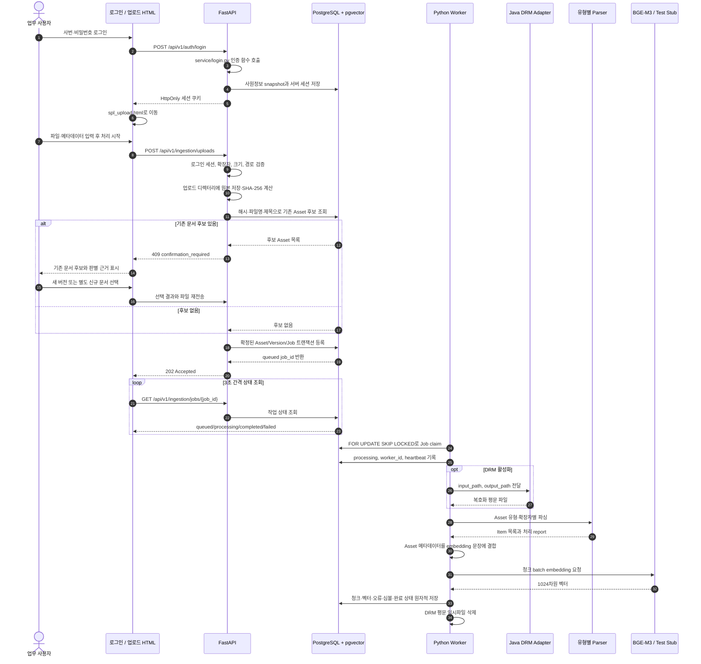
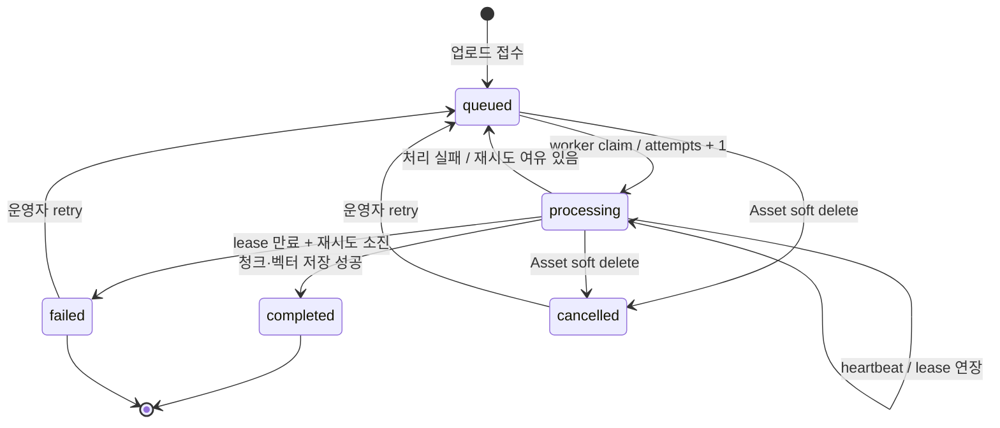
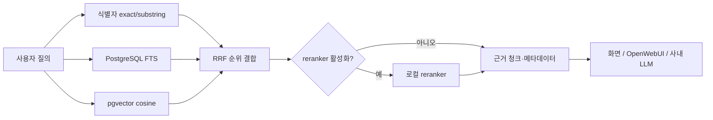

# ECM 문서 자산화 화면·API 업무 프로세스

## 1. 문서 목적

이 문서는 로그인·업로드·검색 화면을 기준으로 사용자의 업무 동작이 어떤 API, Python 함수,
PostgreSQL 테이블과 worker 처리로 연결되는지 설명합니다. 화면 변경 및 코드 리뷰 시
다음 파일을 함께 비교하기 위한 기준 문서입니다.

- 화면: `web/login.html`, `web/spl_upload.html`, `web/upload.html`, `web/search.html`,
  `web/admin.html`
- API 조립: `service/api.py`
- 업로드/상태 API: `service/routes/ingestion.py`
- 자산 API: `service/routes/assets.py`
- 검색 API: `service/routes/search.py`
- 채팅/외부 API: `service/routes/chat.py`, `service/routes/external.py`
- 관리자 API: `service/routes/admin.py`, `service/repositories/admin.py`
- DB repository: `service/repositories/assets.py`, `service/repositories/jobs.py`
- 비동기 처리: `service/worker.py`
- 검색 처리: `service/search.py`
- 공통 답변/스택트레이스 분석: `service/answering.py`, `service/stacktrace.py`
- DB 스키마: `sql/001_pgvector.sql`

RAG는 ECM 문서를 자산화한 뒤 찾고 재사용하기 위한 검색 계층입니다. 화면의 주 업무는
보험약관 질의응답이 아니라 ECM 자산의 원본, 버전, 메타데이터와 처리 이력을 등록하는
것입니다.

현재는 `RAG_AUTH_ENABLED=false`인 임시 모드가 기본이며 첫 화면 `/`이
`spl_upload.html`을 반환합니다. 공통 `authorize()`는 세션 대신 임시 사용자 정보를
반환합니다. 아래 로그인 단계는 향후 `RAG_AUTH_ENABLED=true`로 전환했을 때 적용됩니다.

## 2. 화면에서 보이는 전체 업무 흐름



Mermaid 원문은 Markdown 안에서 직접 수정할 수 있습니다.

## 3. 화면 영역별 코드와 API

### 3.1 사내 로그인과 세션

인증 활성화 후 로그인 화면은 사번과 비밀번호를 `POST /api/v1/auth/login`에 전달합니다.
endpoint는 `service/login.py`의 구현 함수를 호출합니다. 인증 성공 시 반환된
사번·성명·부서·이메일·역할을 PostgreSQL 세션에 snapshot으로 저장하고 브라우저에는
무작위 HttpOnly 쿠키만 발급합니다. 비밀번호와 원문 세션 토큰은 DB에 저장하지 않습니다.

모든 보호 API는 `service.dependencies.authorize()`에서 세션 만료·폐기 여부를 확인합니다.
업로드 완료 시 `upload_audit`에 사원정보, 신규/버전등록 구분, 접속 IP와 User-Agent를
Version/Job과 같은 트랜잭션으로 기록합니다.

### 3.2 자산 식별·분류 영역

| 화면 필드 | API 필드 | 저장 위치 | 의미 |
|---|---|---|---|
| 자산 유형 | `asset_type` | `rag.assets.asset_type` | document, incident, error_trace, source_code |
| 세부 유형 | `subtype` | `rag.assets.subtype` | 업무별 자유 분류 코드 |
| 제목 | `title` | `rag.assets.title` | 비우면 업로드 파일명 사용 |
| 보안등급 | `security_level` | `rag.assets.security_level` | 접근통제 연계를 위한 분류 |

Asset ID는 화면 입력 항목이 아닙니다. 서버가 동일 파일 SHA-256, 저장소 경로, 파일명 또는
제목이 정확히 일치할 때만 기존 문서 후보를 반환합니다. 비슷한 제목만으로는 후보로
판정하지 않습니다. 사용자가 후보를 선택하면
화면이 `confirmed_asset_id`를 내부적으로 전송하고 Version만 추가합니다. 별도 신규 문서를
선택하거나 후보가 없으면 `assets.create_asset()`이 새 UUID를 생성합니다.

### 3.3 업무 메타데이터 영역

| 화면 필드 | API 필드 | DB 컬럼 | 검색 활용 |
|---|---|---|---|
| 제조사 | `vendor` | `assets.vendor` | 검색 filter 및 embedding context |
| 제품 | `product` | `assets.product` | 검색 filter 및 embedding context |
| 시스템명 | `system_name` | `assets.system_name` | 검색 filter 및 embedding context |
| 서비스명 | `service_name` | `assets.service_name` | embedding context |
| 컴포넌트 | `component` | `assets.component` | embedding context |
| 소유 부서 | `owner_org` | `assets.owner_org` | 운영·접근정책 메타데이터 |

화면 표시 원문과 embedding 입력은 분리됩니다. `worker._add_asset_context()`는 위
메타데이터를 embedding 문장에 추가하지만 사용자에게 보여줄 원문은 변경하지 않습니다.

### 3.4 버전·수명주기 영역

| 화면 필드 | API 필드 | DB 컬럼 | 규칙 |
|---|---|---|---|
| 버전 | `version_label` | `asset_versions.version_label` | 업무 버전 문자열 |
| 상태 | `lifecycle_status` | `asset_versions.lifecycle_status` | draft, approved, obsolete |
| 현재 버전 | `is_current` | `asset_versions.is_current` | Asset당 true는 하나만 허용 |

`is_current=true`인 새 버전을 만들면 기존 현재 버전을 false로 바꿉니다. PostgreSQL의
partial unique index가 동시 요청에서도 현재 버전 하나만 허용합니다. 기본 검색은 현재
승인 버전만 대상으로 합니다.

### 3.5 소스코드 전용 영역

| 화면 필드 | API 필드 | 용도 |
|---|---|---|
| 저장소 | `repository` | 소스코드 Asset 필수값 |
| 브랜치 | `branch` | 심볼 출처 추적 |
| 상대 경로 | `logical_path` | 검색 결과 파일 경로 및 심볼 위치 |

`logical_path`는 절대경로, `..`, 역슬래시를 허용하지 않습니다. 실제 서버 파일 경로와
사용자에게 표시할 저장소 논리 경로를 분리하기 위한 필드입니다.

### 3.6 파일 영역과 처리 시작 버튼

버튼을 누르면 화면 JavaScript가 다음 API를 호출합니다.

```http
POST /api/v1/ingestion/uploads
Cookie: ecm_rag_session={HttpOnly session}
Content-Type: multipart/form-data
```

기존 문서 후보가 발견되면 아직 Asset/Version/Job을 만들지 않고 다음 응답을 반환합니다.

```json
{
  "status": "confirmation_required",
  "code": "duplicate_confirmation_required",
  "message": "기존 문서 후보가 발견되었습니다. 등록 방식을 확인해 주세요.",
  "candidates": [
    {
      "asset_id": "UUID",
      "title": "전자결재 운영지침",
      "current_version_label": "1.0",
      "source_filename": "approval-guide.pdf",
      "exact_content": false,
      "match_reasons": ["동일한 제목", "동일한 파일명"]
    }
  ]
}
```

사용자가 결정하면 동일 파일을 `duplicate_action=new_version`과 내부
`confirmed_asset_id` 또는 `duplicate_action=new_asset`으로 다시 전송합니다. 동일한
파일 내용이 이미 등록된 후보에는 중복 Version을 만들 수 없습니다.

정상 응답은 처리 완료가 아니라 접수 완료입니다.

```json
{
  "asset_id": "UUID",
  "version_id": "UUID",
  "job_id": "UUID",
  "status": "queued",
  "size": 12345
}
```

화면은 받은 `job_id`로 3초마다 다음 API를 호출합니다.

```http
GET /api/v1/ingestion/jobs/{job_id}
Cookie: ecm_rag_session={HttpOnly session}
```

3초 간격으로 최대 60분간 조회하며 `completed` 또는 `failed`이면 polling을 종료합니다.
자동 확인 시간이 끝나더라도 서버 작업은 중단되지 않으므로 작업 API 또는 worker 로그로
계속 확인할 수 있습니다.

## 4. 작업 상태 전이



| 상태 | 화면 의미 | DB 처리 |
|---|---|---|
| queued | 처리 대기 | worker가 claim 가능한 상태 |
| processing | 파싱·임베딩·적재 중 | worker_id, heartbeat_at 기록 |
| completed | 검색 가능한 상태 | chunk_count, report, completed_at 기록 |
| failed | 자동 재시도 소진 | error_detail 확인 후 운영자 재시도 |
| cancelled | 자산 삭제 등으로 취소 | 명시적 retry 전에는 처리하지 않음 |

재시도 API:

```http
POST /api/v1/ingestion/jobs/{job_id}/retry
Cookie: ecm_rag_session={HttpOnly session}
```

## 5. Asset 관리 API

업로드 화면은 주로 등록과 상태 조회를 사용하지만, 관리 화면이나 OpenWebUI 연계에서는
다음 API로 ECM 자산을 관리할 수 있습니다.

| Method | Endpoint | 업무 기능 | 주요 결과 |
|---|---|---|---|
| POST | `/api/v1/assets` | 파일 없이 Asset 메타데이터 생성 | `201` |
| GET | `/api/v1/assets` | 활성 Asset 목록/필터 조회 | `200` |
| GET | `/api/v1/assets/{asset_id}` | Asset 단건 조회 | `200`, 미존재 `404` |
| PATCH | `/api/v1/assets/{asset_id}` | 전달한 필드만 수정 | `200` |
| DELETE | `/api/v1/assets/{asset_id}` | soft delete 및 진행 작업 취소 | `204` |
| GET | `/api/v1/assets/{asset_id}/versions` | 버전 이력 조회 | 내부 `source_path` 제외 |
| GET | `/api/v1/assets/{asset_id}/upload-history` | 사원별 문서 접수 감사 이력 | 사번·성명·부서·등록 구분 |
| POST | `/api/v1/assets/{asset_id}/relations` | Asset 관계 생성 | `201`, 충돌 `409` |
| GET | `/api/v1/assets/{asset_id}/relations` | 연관 자산 조회 | `200` |
| DELETE | `/api/v1/assets/{asset_id}/relations/{target_id}/{type}` | 관계 삭제 | `204` |

삭제는 물리 삭제가 아닙니다. `assets.deleted_at`을 기록해 일반 조회와 검색에서 제외하고
대기·처리 중 작업을 cancelled로 바꿉니다. 버전과 기존 처리 결과는 감사 및 계보를 위해
보존합니다.

### 5.1 관리자 화면의 RDB·pgvector 관리

`/admin.html`의 **데이터 관리** 화면은 일반 자산 API와 별도의 `/api/v1/admin`
router를 사용합니다. 인증이
활성화된 환경에서는 세션의 `roles`에 `admin`이 있어야 하며, 임시 인증 모드에서는
운영망 ACL로 접근 PC를 제한해야 합니다.

| Method | Endpoint | 기능 | 삭제/갱신 규칙 |
|---|---|---|---|
| GET | `/api/v1/admin/stats` | 활성·삭제 자산, 버전, 청크, 작업 집계 | 읽기 전용 |
| GET/POST | `/api/v1/admin/assets` | 삭제 포함 자산 조회/생성 | 생성은 RDB metadata만 등록 |
| PATCH/DELETE | `/api/v1/admin/assets/{id}` | 자산 수정/논리 삭제 | Version과 청크는 보존 |
| POST | `/api/v1/admin/assets/{id}/restore` | 논리 삭제 자산 복구 | 취소 작업은 자동 재시도하지 않음 |
| GET | `/api/v1/admin/versions` | 청크 대상 Version 조회 | 원본 서버 경로는 노출하지 않음 |
| GET/POST | `/api/v1/admin/chunks` | 청크 조회/생성 | 본문으로 vector 자동 생성 |
| PATCH/DELETE | `/api/v1/admin/chunks/{id}` | 청크 수정/물리 삭제 | 본문 수정 시 vector 재생성, 삭제 시 오류·심볼 cascade |
| GET | `/api/v1/admin/jobs` | 처리 작업·오류 조회 | 읽기 전용 |
| POST | `/api/v1/admin/jobs/{id}/retry` | 실패/취소 작업 재시도 | attempts를 초기화하고 queued 전환 |

raw vector 배열은 크고 사람이 안전하게 수정하기 어렵기 때문에 화면과 응답에서 제외합니다.
대신 `embedding_model`과 `embedding_dimensions`를 표시하고, 청크 저장 시 현재 profile의
임베딩 adapter를 호출해 설정 차원을 검증한 후 본문과 vector를 같은 트랜잭션에 저장합니다.

## 6. 검색·답변 화면과 외부 연계 흐름

임시 모드의 첫 화면과 인증 활성화 후 로그인 성공 기본 화면은 모두
`/spl_upload.html`입니다. 간편 화면은 자산유형·제목·원본파일만
입력하고 제목은 선택한 파일명을 기본값으로 사용합니다. 상세 입력이 필요하면
`/upload.html`을 사용합니다. 두 업로드 화면의 우측 처리 파이프라인 아래에서
`search.html`로 이동할 수 있고, 검색 화면 상단의 문서 업로드 메뉴는
`spl_upload.html`로 돌아갑니다.

검색 요청:

```http
POST /api/v1/search
Cookie: ecm_rag_session={HttpOnly session}
Content-Type: application/json

{
  "query": "전자결재 연계 운영지침",
  "asset_type": "document",
  "system_name": "전자결재",
  "include_obsolete": false,
  "limit": 10
}
```



`/api/v1/search`는 답변을 생성하지 않고 Asset/Version/파일명/페이지·라인/근거 청크와
검색 점수를 반환합니다. `search.html`은 같은 검색기를 사용하는 `/api/v1/chat`을 호출해
근거 기반 LLM 답변과 검색 결과를 함께 유지합니다. 결과 카드를 누르면 원본 다운로드
endpoint를 호출하며 인증 활성화 후에는 세션도 검증합니다. 관련 근거가 없으면
`generation_status=out_of_scope`로
문서 관련 질문만 지원한다는 안내를 반환하고 LLM은 호출하지 않습니다.

내부 시스템은 세션/API 키 없이 다음 endpoint를 호출할 수 있습니다.

```http
POST /api/v1/external/answer
Content-Type: application/json 또는 text/plain
```

JSON 객체·JSON 문자열·일반 문자열을 지원하며 요청 본문은 16KiB 이하입니다. JSON의
`stack_trace` 필드를 사용하면 예외 유형, root cause, 오류 코드, Java frame,
애플리케이션 frame과 fingerprint를 구조화하고 package/class/method 검색어를 추가합니다.
응답은 공통 `answer`, `generation_status`, `notices`, `results`와 함께
`request_type`, 필요 시 `stack_trace_analysis`를 포함합니다. 무인증 endpoint이므로
운영 배포에서는 방화벽/reverse proxy로 사내 허용 대역만 접근시켜야 합니다.

## 7. 유형별 worker 처리

| Asset 유형/확장자 | 파서 | 주요 산출물 |
|---|---|---|
| document `.pdf` | Docling + 표 정규화 | docling.json, canonical.json, markdown, chunks |
| document `.docx` | python-docx | 문단·표 행 청크 |
| document `.txt/.md` | 텍스트 파서 | 문단 기반 청크 |
| incident `.txt/.md` | 장애 필드 파서 | 증상·원인·조치·결과 구조화 |
| error_trace `.log/.txt` | 로그/스택 파서 | 오류 이벤트, 코드, stack frame |
| source_code `.py` | Python AST | 클래스·함수 심볼과 라인 |
| source_code `.java` | 순수 Python Java 안전 분석기 | 패키지·클래스·메서드·예외·오류코드 |
| source_code `.jar` | CFR + Java 안전 분석기 | 디컴파일 소스, JAR index, 심볼·예외·오류코드 |
| 기타 코드 | 파일 청크 | 저장소·브랜치·논리 경로 |

모든 파서는 공통 `Item` 목록과 report를 반환합니다. worker는 Item 수와 embedding 벡터
수가 같은지 확인한 뒤 `jobs.complete_job()`의 단일 트랜잭션으로 저장합니다.

## 8. 오류 응답과 화면 확인 기준

| 상황 | HTTP/상태 | 화면/운영자 조치 |
|---|---|---|
| 인증 활성화 후 세션 누락·만료 | `401` | 로그인 화면으로 이동해 재인증 |
| `login.py` 미구현·연동 실패 | `503` | `authenticate_employee()` 구현과 사내 연동 상태 확인 |
| 허용하지 않은 유형·확장자 | `422` | Asset 유형과 파일 확장자 확인 |
| 빈 파일 | `422` | 원본 파일 확인 |
| 용량 초과 | `413` | profile의 `max_upload_mb`와 파일 크기 확인 |
| 기존 문서 후보 발견 | `409` + `duplicate_confirmation_required` | 새 버전 또는 별도 신규 문서 선택 |
| 확인 대상 Asset 불일치 | `409` | 후보를 다시 조회한 뒤 선택 |
| 동일 원본 SHA-256 중복 | `409` | 기존 버전 확인 |
| DB 준비 안 됨 | `/health/ready` `503` | PostgreSQL/DSN/스키마 확인 |
| worker 처리 오류 | job `queued` 또는 `failed` | `error_detail`, attempts 확인 |
| 관련 문서 없음 | `200`, `generation_status=out_of_scope` | 지원 범위 안내, LLM 미호출 |
| LLM 장애 | `200`, `generation_status=unavailable` | 검색 결과·원문 확인, 모델 서버 점검 |
| 디컴파일 근거 포함 | `200`, `notices` 포함 | line보다 package/class/method 우선 확인 |
| 관리자 권한 없음 | `403` | 사내 인증 응답의 `roles`에 `admin` 포함 여부 확인 |
| 관리자 청크 임베딩 실패 | `502` | 임베딩 URL·모델·응답 차원 확인, 기존 청크는 유지 |

## 9. 코드 리뷰 체크리스트

### 화면 변경

- HTML `name`과 `ingestion.upload()` Form 파라미터가 동일한가?
- 로그인 비밀번호와 원문 세션 토큰이 DB·로그·응답에 남지 않는가?
- 임시 모드에서는 공통 임시 사용자를, 인증 모드에서는 HttpOnly 세션을 검증하는가?
- Asset ID를 사용자에게 직접 입력시키지 않고 후보 선택값으로만 전송하는가?
- 기존 문서 후보가 자동 병합되지 않고 사용자 확인 단계를 거치는가?
- 새 terminal 상태가 추가되면 polling 종료 조건도 변경했는가?
- 브라우저 검증만 믿지 않고 서버 검증도 존재하는가?
- 관리자 화면이 raw vector를 직접 입력·노출하지 않는가?
- 관리자 청크 삭제 전에 영구 삭제와 연결 데이터 cascade를 명확히 안내하는가?

### API 변경

- route는 HTTP 책임만 갖고 SQL을 repository에 위임하는가?
- 내부 `source_path`, `worker_id`, lease 정보가 응답에 노출되지 않는가?
- 오류가 401/404/409/422/503 등 의미 있는 상태 코드로 변환되는가?

### DB·queue 변경

- Version과 Job 생성이 한 트랜잭션인가?
- 다중 worker claim에 `FOR UPDATE SKIP LOCKED`가 유지되는가?
- lease를 잃은 worker가 결과를 덮어쓰지 못하는가?
- 재처리 시 이전 부분 청크가 남지 않는가?

### 보안·DRM 변경

- 업로드 경로가 설정된 upload_root 내부인지 확인하는가?
- subprocess를 shell 문자열로 실행하지 않는가?
- 복호화 평문 임시파일이 성공·실패 모두에서 삭제되는가?
- 비밀값이 YAML, 로그, API 응답에 포함되지 않는가?

### 검색 변경

- exact/FTS/vector 모든 lane에 같은 보안·수명주기 필터가 적용되는가?
- embedding 차원과 PostgreSQL `vector(N)`이 일치하는가?
- 사용자 표시 원문과 embedding용 문장을 혼동하지 않는가?
- 검색 결과에 Asset/Version/파일/페이지 또는 라인 근거가 포함되는가?
- 브라우저 채팅과 외부 API가 `answer_documents()`의 같은 검색·답변 정책을 사용하는가?
- JAR 근거가 포함되면 디컴파일 라인 차이 안내가 답변과 `notices`에 표시되는가?
- 무관한 질문은 LLM을 호출하지 않고 `out_of_scope`로 구분되는가?

## 10. 관련 검증

자동 통합 테스트는 `tests/integration/test_postgres_service.py`에 있습니다. PostgreSQL
테스트 DSN을 설정하면 상태 확인, 인증, Asset CRUD, 업로드, worker, pgvector 적재와
검색 round-trip을 검증합니다. 실행 방법은 `tests/integration/README.md`를 참고합니다.
